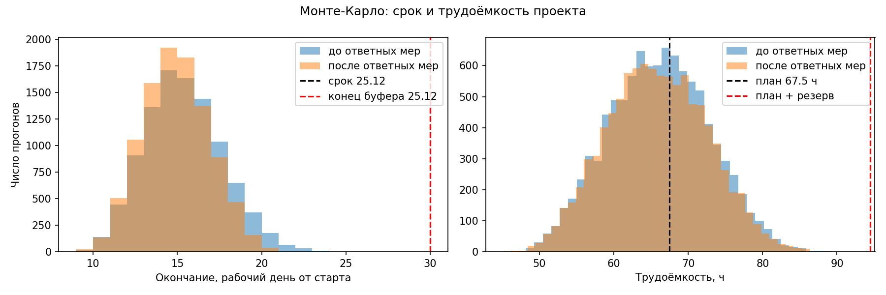

# Реестр рисков

<!-- TODO: шаги 1–3 и 8 задания ЛР 4. Реестр — живой документ: обновляйте его на каждом обзоре спринта. -->

Версия: <...> · Дата: <...> · Владелец реестра: <...>

## 1. Шкалы

| Балл | Вероятность за проект | Влияние на срок | Влияние на бюджет | Влияние на качество | Влияние на ценность для заказчика |
|---|---|---|---|---|---|
| 1 | до 10% | до 1 дня | до 2 ч | Незаметно заказчику | Незаметно |
| 2 | 10–30% | 1–2 дня | 2–5 ч | Мелкий недочёт в одном результате | Одна второстепенная функция теряет смысл |
| 3 | 30–50% | 3–5 дней, в пределах буфера | 5–10 ч | Заметный недочёт, исправляется в следующем спринте | Заказчик сомневается в части продукта |
| 4 | 50–70% | Больше буфера | 10–15 ч, весь резерв | Ошибочный вывод в отчёте | Заказчик может выбрать другое решение для основной задачи |
| 5 | более 70% | Срыв защиты | Больше резерва | Продукт непригоден для заказчика | Продукт не нужен заказчику |

Оценка риска = вероятность × влияние (берётся максимальное из четырёх влияний).
- 15–25 — высокий: ответная мера сейчас, контроль на каждой синхронизации;
- 8–14 — средний: ответная мера в ближайшем спринте, контроль на обзоре;
- 1–7 — низкий: наблюдаем.

## 2. Матрица рисков

<!-- Впишите номера рисков в клетки -->

| Вероятность \ Влияние | 1 | 2 | 3 | 4 | 5 |
|---|---|---|---|---|---|
| **5** | | | | | |
| **4** | | | | | |
| **3** | | | | | |
| **2** | | | | | |
| **1** | | | | | |

## 3. Реестр

| № | Категория (RBS) | Причина → событие → последствие | В | Вл | Оценка | Стратегия | Ответная мера | Триггер | Владелец | Резерв | Статус | Issue |
|---|---|---|---|---|---|---|---|---|---|---|---|---|
| R1 | | Из-за … может произойти …, что приведёт к … | | | | | | | | | | # |

## 4. Возможности

| № | Причина → событие → выгода | В | Вл | Оценка | Стратегия | Мера | Владелец | Issue |
|---|---|---|---|---|---|---|---|---|
| O1 | | | | | | | | # |

## 5. Количественный анализ

### Монте-Карло

Ноутбук: `notebooks/05_risk_monte_carlo.ipynb`. Параметры рисков в модели:

| Риск | Работа | Вероятность до / после мер | Дни до / после | Часы до / после |
|---|---|---|---|---|
| R1. Нет данных о трафике | 2.1 Модель оценки спроса | 0.50/0.50 | 2/2 | 8/8 |
| R2. Выпадение участника | 1.1 Сбор и очистка данных | 0.20/0.10 | 3/1 | 2/2 |
| R3. Учебная нагрузка | 3.1 Интерактивная карта | 0.40/0.40 | 2/2 | 5/5 |
| R4. Тяжелые вычисления | 2.2 Пространственный анализ | 0.20/0.10 | 1/1 | 2/2 |

Результаты:

| Сценарий | P(в срок) | P(в буфер) | Срок P50 | Срок P85 | Часы P50 | Часы P85 | P(часы ≤ план + резерв) |
|---|---|---|---|---|---|---|---|
| Только оценки | 100.00% | 100.00% | 02.12 | 04.12 | 59.1 | 64.3 | 100.00% |
| До ответных мер | 100.00% | 100.00% | 07.12 | 09.12 | 66.1 | 73.2 | 100.00% |
| После ответных мер | 100.00% | 100.00% | 04.12 | 09.12 | 65.7 | 73.0 | 100.00% |

**Работы, сильнее всего влияющие на срок:**
1. Модель оценки спроса (2.1) - чувствительность 0.56, критичность 100%.
2. Интерактивная карта (3.1) - чувствительность 0.56, критичность 98.35%.
3. Сбор и очистка данных (1.1) - чувствительность 0.51, критичность 100%.

**Риски с наибольшим сдвигом финиша:**
1. R2. Выпадение участника - сдвиг на 3.03 дня.
2. R3. Учебная нагрузка - сдвиг на 2.02 дня.
3. R1. Нет данных о трафике - сдвиг на 1.97 дня.

Вывод для спонсора:
С вероятностью 100% проект завершится до 25.12.2026. Главные угрозы сроку - выпадение участника команды и учебная нагрузка. Ответные меры по снижению вероятности этих рисков доказали свою эффективность, сократив разброс сроков. Трудоемкость с вероятностью 100% укладывается в план + резерв.

### Дерево решений

Риск: R1 (отсутствие данных о трафике)

| Вариант | Затраты сейчас | Исходы (вероятность, последствия) | EMV | Ожидаемая задержка | Худший случай |
|---|---|---|---|---|---|
| A. Рассчитывать на прокси-метрики (парковки, ТЦ) | 0 | 0.5 (8ч, 2д), 0.5 (0, 0) | 4.8 | 0.8 | 12 |
| B. Собирать данные о трафике вручную | 4 | 0.1 (8ч, 2д), 0.9 (0, 0) | 4.6 | 0.1 | 16 |

Решение и почему:
Выбираем Вариант A. Хотя EMV у вариантов почти одинаковый, у варианта A меньше худший случай и он не требует немедленных затрат времени. Кроме того, ручной сбор данных о трафике технически невозможен из-за их отсутствия в открытом доступе. Использование прокси-метрик (плотность парковок и ТЦ) полностью соответствует нашей стратегии снижения риска R1.

## 6. Правовые и этические риски

| Вопрос | Что у нас | Что делаем | Где зафиксировано |
|---|---|---|---|
| Лицензии источников данных | | | |
| Атрибуция на карте и в отчёте | | | |
| Производная база данных | | | |
| Персональные данные | | | |
| Смещение данных и справедливость выводов | | | |
| Использование ИИ | | | |

## 7. История изменений

| Дата | Что изменилось | Почему |
|---|---|---|
| | | |
