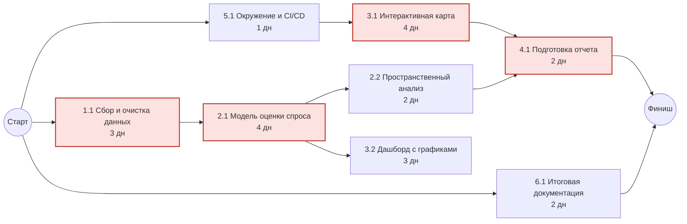
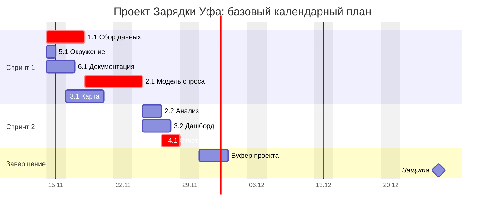

# Календарный план и ресурсы

Базовый план, версия 1.0, утверждён 14.11.2026. Изменения после утверждения — только через запрос на изменение.

## 1. Доступное время

- Период разработки: 14.11.2026 — 25.12.2026, 30 рабочих дней (6 недель).
- Нерабочие дни: 4 ноября (праздник, но он до начала периода). Также учитываем возможные сессии/зачеты в середине декабря.
- Жёсткие вехи: Защита проекта — 25 декабря 2026 года.

## 2. Сетевой график

| Работа | Длит., дн | Предшественники | ES | EF | LS | LF | Резерв |
|---|---|---|---|---|---|---|---|
| 5.1 Окружение | 1 | - | 0 | 1 | 6 | 7 | 6 |
| 1.1 Сбор данных | 3 | - | 0 | 3 | 0 | 3 | **0** |
| 2.1 Модель спроса | 4 | 1.1 | 3 | 7 | 3 | 7 | **0** |
| 2.2 Простр. анализ | 2 | 2.1 | 7 | 9 | 9 | 11 | 2 |
| 3.1 Интерактивная карта | 4 | 5.1 | 1 | 5 | 3 | 7 | 2 |
| 3.2 Дашборд | 3 | 2.1 | 7 | 10 | 8 | 11 | 1 |
| 4.1 Отчет | 2 | 2.2, 3.1 | 9 | 11 | 9 | 11 | **0** |
| 6.1 Документация | 2 | - | 0 | 2 | 9 | 11 | 9 |

**Критический путь:** 1.1 → 2.1 → 4.1. Длина: 11 рабочих дней.

Выводы и решения: Критический путь идет через данные (сбор и модель спроса) к отчету. Если данные задержатся, проект сдвинется. Работа 2.2 имеет резерв 2 дня, но она нужна для отчета. Поэтому менеджеру нужно следить за сбором данных в первую очередь.

## 3. Диаграмма Ганта

Буфер: 3 дня. Как рассчитан: Разница между оценкой с уверенностью 85% (72,4 ч) и ожидаемой трудоёмкостью (67,5 ч) составляет около 5 часов. С учётом того, что в конце семестра могут возникнуть накладки с другими предметами и сессией, а также из-за округления рабочих дней, буфер увеличен до 3 рабочих дней перед защитой.

## 4. Ресурсы

Ёмкость на продукт: 5 часов в неделю на человека, 10 часов за двухнедельный спринт. Отсутствий не планируется.

### Матрица загрузки до выравнивания

| Участник | Sprint 1 | Sprint 2 | Sprint 3 | Sprint 4 |
|---|---|---|---|---|
| Анна (Менеджер) | 6 ч | 4 ч | 6 ч | 4 ч |
| Даша А. (Владелец) | 8 ч | 8 ч | 2 ч | 4 ч |
| Даша С. (Техлид) | 12 ч (перегруз) | 6 ч | 8 ч | 2 ч |

### Решения по выравниванию

1. В Sprint 1 у Даши С. перегруз (12 часов при ёмкости 10), так как на неё свалены и техническая часть (окружение 5.1), и карта (3.1). Передаем настройку окружения (5.1) Анне (менеджеру), так как это организационная задача.
2. В Sprint 2 у Даши А. недогруз (всего 8 часов из 10). Передаем ей подготовку структуры отчета (4.1) из Sprint 3, чтобы разгрузить конец проекта.

### Матрица загрузки после выравнивания

| Участник | Sprint 1 | Sprint 2 | Sprint 3 | Sprint 4 | Всего |
|---|---|---|---|---|---|
| Анна | 7 ч | 4 ч | 6 ч | 4 ч | 21 ч |
| Даша А. | 8 ч | 8 ч | 4 ч | 4 ч | 24 ч |
| Даша С. | 8 ч | 6 ч | 6 ч | 2 ч | 22 ч |
| **Команда** | 23 из 30 | 18 из 30 | 16 из 30 | 10 из 15 | **67 из 105** |

## 5. Релизный план

| Спринт | Даты | Цель спринта | Истории (SP) | Пакеты WBS | Релиз |
|---|---|---|---|---|---|
| Sprint 1 | 14.11 - 27.11 | Собрана база данных, рассчитана аналитическая модель спроса | US-1 (5), US-2 (8) |  1.1, 2.1, 5.1 | v0.1-initiation |
| Sprint 2 | 28.11 - 11.12 | Заказчик видит интерактивную карту с приоритетными площадками | US-3 (5) |3.1, 3.2 | v0.2-scope |
| Sprint 3 | 12.12 - 18.12 | Сформирован список приоритетных площадок, данные выгружены для департамента | US-4 (3) | 4.1, 4.2 | v0.3|
| Sprint 4 | 21.12 - 25.12 | Продукт опубликован, документация и отчет готовы к защите | US-5 (3) | 5.2, 6.1, 6.2, 6.3 | v1.0 |

Гипотеза скорости: 4-5 SP за спринт. Что переносим, если скорость не подтвердится: Если в Sprint 1 команда закроет меньше 5 SP, то US-4 (Экспорт в CSV, 3 SP) переносится в Sprint 4. Публикация карты (US-3) — критический путь, поэтому она не переносится.

Roadmap на доске: [Roadmap проекта](https://github.com/users/dddashydrly/projects/3/views/3)

Настроен обзорный вид (масштаб Month) с шестью эпиками (E1–E6) и вертикальными маркерами спринтов. Эпик E6 «Управление проектом» длится сквозь весь проект (с 16.11 по 25.12), так как включает сборку устава, статус-отчеты и финальную защиту. Эпик E3 «Пользовательский интерфейс» запланирован на период с 30.11 по 11.12 (Sprint 2), так как для построения карты сначала нужны готовые данные и модель спроса (E1, E2). Остальные эпики (E1, E2, E4, E5) распределены по спринтам согласно релизному плану.

