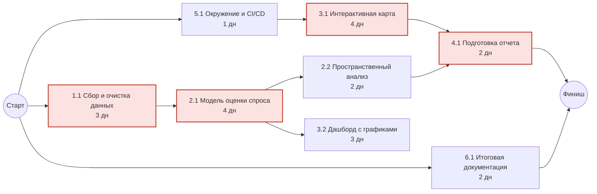

# Календарный план и ресурсы

Базовый план, версия 1.0, утверждён 14.11.2026. Изменения после утверждения — только через запрос на изменение.

## 1. Доступное время

- Период разработки: 14.11.2026 — 25.12.2026, 30 рабочих дней (6 недель).
- Нерабочие дни: 4 ноября (праздник, но он до начала периода). Также учитываем возможные сессии/зачеты в середине декабря.
- Жёсткие вехи: Защита проекта — 25 декабря 2026 года.

## 2. Сетевой график



| Работа | Длит., дн | Предшественники | ES | EF | LS | LF | Резерв |
|---|---|---|---|---|---|---|---|
| 5.1 Окружение | 1 | - | 0 | 1 | 6 | 7 | 6 |
| 1.1 Сбор данных | 3 | - | 0 | 3 | 0 | 3 | **0** |
| 2.1 Модель спроса | 4 | 1.1 | 3 | 7 | 3 | 7 | **0** |
| 2.2 Простр. анализ | 2 | 2.1 | 7 | 9 | 9 | 11 | 2 |
| 3.1 Интерактивная карта | 4 | 5.1 | 1 | 5 | 3 | 7 | 2 |
| 3.2 Дашборд | 3 | 2.1 | 7 | 10 | 8 | 11 | 1 |
| 4.1 Отчет | 2 | 2.2, 3.1 | 9 | 11 | 9 | 11 | **0** |
| 6.1 Документация | 2 | - | 0 | 2 | 9 | 11 | 9 |

**Критический путь:** 1.1 → 2.1 → 4.1. Длина: 11 рабочих дней.

Выводы и решения: Критический путь идет через данные (сбор и модель спроса) к отчету. Если данные задержатся, проект сдвинется. Работа 2.2 имеет резерв 2 дня, но она нужна для отчета. Поэтому менеджеру нужно следить за сбором данных в первую очередь.

## 3. Диаграмма Ганта

```mermaid
gantt
    title <Проект>: базовый календарный план
    dateFormat YYYY-MM-DD
    axisFormat %d.%m
    excludes weekends
    section Спринт 1
    <работа> :crit, a, <дата>, <N>d
    Буфер проекта :buf, after a, <N>d
    Защита :milestone, m, <дата>, 0d
```

Буфер: <N> дней. Как рассчитан: <...>

## 4. Ресурсы

Ёмкость на продукт: <ч в неделю> на человека, <ч> за двухнедельный спринт. Отсутствия: <...>

### Матрица загрузки до выравнивания

| Участник | Sprint 1 | Sprint 2 | Sprint 3 | Sprint 4 |
|---|---|---|---|---|
| | | | | |

### Решения по выравниванию

1. <...>

### Матрица загрузки после выравнивания

| Участник | Sprint 1 | Sprint 2 | Sprint 3 | Sprint 4 | Всего |
|---|---|---|---|---|---|
| | | | | | |

## 5. Релизный план

| Спринт | Даты | Цель спринта | Истории (SP) | Пакеты WBS | Релиз |
|---|---|---|---|---|---|
| | | | | | |

Гипотеза скорости: <...> SP за спринт. Что переносим, если скорость не подтвердится: <...>

Roadmap на доске: <ссылка на представление>
