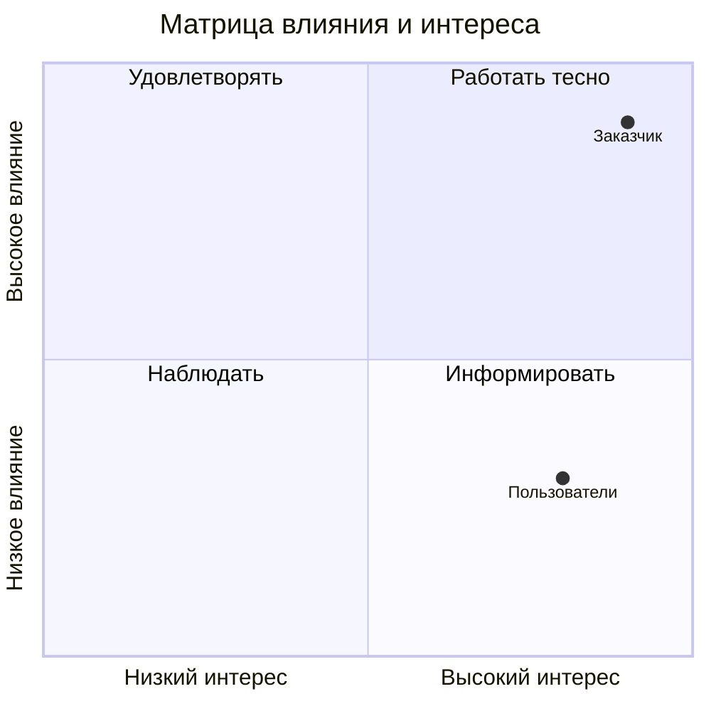

# Стейкхолдеры, матрица влияния и интереса, RACI

<!-- TODO: шаг 4 задания ЛР 1. Минимум 8 стейкхолдеров и 8 работ в RACI. -->

## Реестр
| Стейкхолдер | Роль | Что ожидает | Влияние (1–5) | Интерес (1–5) | Как работаем |
|---|---|---|---|---|---|
| | | | | | |

## Матрица влияния и интереса
Координаты по осям от 0 до 1. Замените примеры своими стейкхолдерами.

## RACI
В каждой строке ровно одна буква A.

| Работа | Менеджер проекта (Даша С.) | Аналитик (Анна) | Тех. организатор (Даша А.) | Заказчик |
|---|---|---|---|---|
| Устав проекта |A/R|C|I|C|
|Реестр стейкхолдеров и матрица|A|R|I|C|
|Настройка репозитория и доски|A|I|R|I|
|Проблема и бизнес-обоснование|A|R|I|C|
|Цели SMART и показатели|R|A|I|C|
|Интервью с заказчиком, протокол|C|A/R|I|C|
|Реестр рисков|A|C|R|I|
|Выбор подхода, ADR-001|A|C|R|C|
|Модель оценки спроса|A|R|R|I|
|Сборка устава|A/R|C|I|C|
|Защита проекта|A|R|R|A|

## Интервью с заказчиком
Протокол: [docs/meetings/](meetings/)
