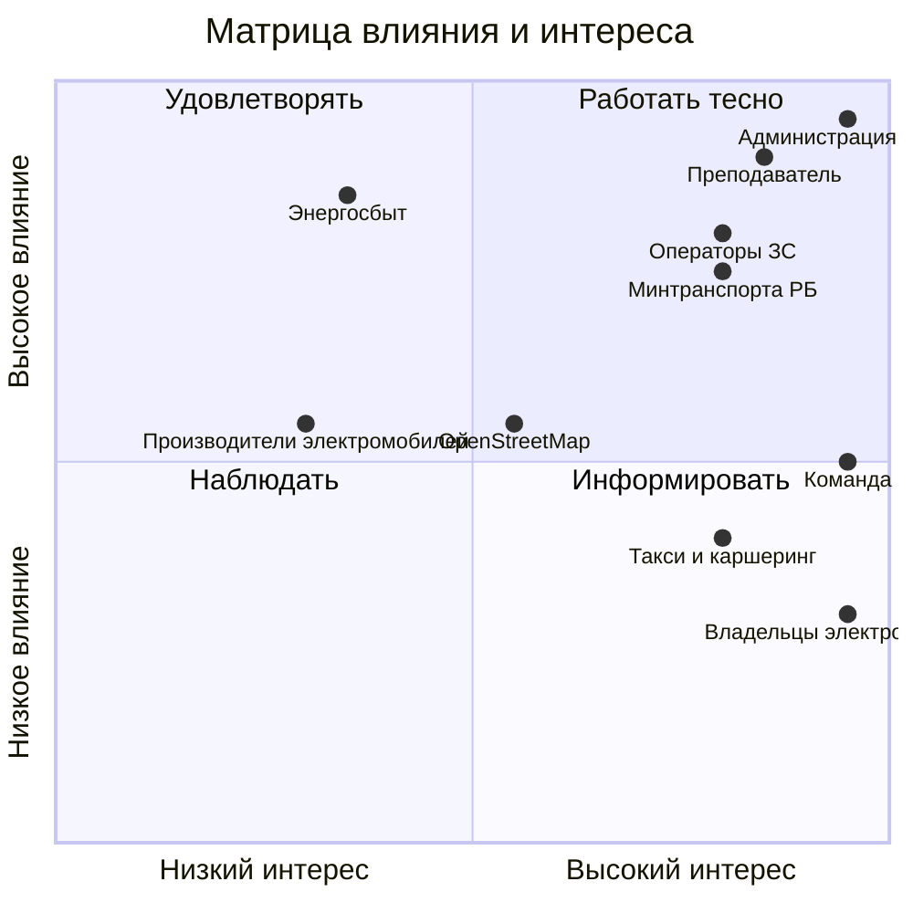

# Стейкхолдеры, матрица влияния и интереса, RACI

<!-- TODO: шаг 4 задания ЛР 1. Минимум 8 стейкхолдеров и 8 работ в RACI. -->

## Реестр
| Стейкхолдер | Роль | Что ожидает | Влияние (1–5) | Интерес (1–5) | Как работаем |
|---|---|---|---|---|---|
|Администрация г. Уфа (управление транспорта)|Заказчик|Обоснование, где строить новые зарядные станции|5|5|Еженедельный статус, демонстрации|
|Владельцы электромобилей в Уфе и регионе|Пользователи|Доступные зарядки на городских и междугородних маршрутах|2|5|Тестируем на малой группе, собираем отзывы|
|Операторы такси и каршеринга|Пользователи-бизнес|Предсказуемые точки зарядки для автопарка|3|5|Интервью, показываем результаты анализа|
|Операторы зарядных сетей (Россети, частные)|Потребители результата	|Понятные данные для планирования новых точек|4|4|Консультации, показываем рейтинг площадок|
|Энергосбытовые компании / сетевые организации|Регулятор / поставщик|Отсутствие перегрузок на сетях при новых подключениях|4|2|Консультируемся по мощности подключения|
|Министерство транспорта Республики Башкортостан|Регулятор|Развитие зарядной инфраструктуры в регионе|4|4|Информируем, согласуем метрики|
|OpenStreetMap и открытые карты|Источник данных|Корректное использование, указание авторства|3|3|Следим за лицензией, атрибуция|
|Производители электромобилей|Смежная сторона|Развитие инфраструктуры для роста продаж|3|2|Информируем о результатах|
|Преподаватель|Куратор / спонсор|Соответствие требованиям курса|5|4|Плотно, на каждой контрольной точке|
|Команда проекта|Исполнители|Понятные задачи и сроки|3|5|Внутренние встречи, доска GitHub|

## Матрица влияния и интереса

## RACI
В каждой строке ровно одна буква A.

| Работа | Менеджер проекта (Даша С.) | Аналитик (Анна) | Тех. организатор (Даша А.) | Заказчик |
|---|---|---|---|---|
| Устав проекта |A/R|C|I|C|
|Реестр стейкхолдеров и матрица|A|R|I|C|
|Настройка репозитория и доски|A|I|R|I|
|Проблема и бизнес-обоснование|A|R|I|C|
|Цели SMART и показатели|R|A|I|C|
|Интервью с заказчиком, протокол|C|A/R|I|C|
|Реестр рисков|A|C|R|I|
|Выбор подхода, ADR-001|A|C|R|C|
|Модель оценки спроса|A|R|R|I|
|Сборка устава|A/R|C|I|C|
|Защита проекта|A|R|R|A|

## Интервью с заказчиком
Протокол: [docs/meetings/](meetings/)
