# Иерархическая структура работ (WBS)

<!-- TODO: шаг 3 задания ЛР 2. WBS делит результаты проекта, а не действия. Первый уровень совпадает с эпиками E1–E6. Правило 100%: в WBS есть все работы проекта и ничего лишнего. Пакет работ: 8–80 часов, один ответственный, проверяемый результат. -->

## Диаграмма 

```mermaid
flowchart TD
    P[0. Размещение зарядных станций электромобилей]
    P --> D[1. Данные · E1]
    P --> A[2. Аналитика · E2]
    P --> U[3. Пользовательский интерфейс · E3]
    P --> R[4. Отчётность · E4]
    P --> Q[5. Платформа и качество · E5]
    P --> M[6. Управление проектом · E6]
    D --> D1[1.1 Реестр источников]
    D --> D2[1.2 Сырые данные и инструкции размещения]
    D --> D3[1.3 Отчет о качестве]
    D --> D4[1.4 Очищенные данные]
    A --> A1[2.1 Расположение существующих АЗС на карте]
    A --> A2[2.2 Анализ трафика]
    A --> A3[2.3 Плотность населения]
    A --> A4[2.4 Отмечены технические возможности зарядных станций]
    U --> U1[3.1 Картограмма районов]
    U --> U2[3.2 Зарядочные станции на карте]
    U --> U3[3.3 Загруженность и работоспособность станций]
    R --> R1[4.1 Рекомендации по размещению]
    R --> R2[4.2 Выгрузки для депаратмента]
    Q --> Q1[5.1 Окружение и автопроверки]
    Q --> Q2[5.2 Публикация на GitHub Pages]
    M --> M1[6.1 Устав и планы]
    M --> M2[6.2 Статус-отчеты и обзоры]
    M --> M3[6.3 Итоговый отчет и защита]
    
```

## Словарь WBS

Для каждого пакета работ (нижний уровень WBS).

| Код | Пакет работ | Результат | Критерий готовности | Ответственный | Оценка, ч | Эпик / Issues |
|---|---|---|---|---|---|---|
| 1.1 | Реестр источников | data/sources.md | 3 источника, все поля заполнены, оценка по шкале 1–5 | Анна П. | 2 | E1, #41 |
| 1.2 | Сырые данные и инструкции размещения | data/raw/ | Набор данных, соответствующий требованиям | Анна П. | 6 | E1, #42 |
| 1.3 | Отчет о качестве | docs/data-quality.md | Профиль по всем слоям, проблемы заведены задачами| Анна П. | 3 | E1, #43 |
| 1.4 | Очищенные данные | data/processed/ | Данные очищены | Анна П. | 6 | E1, #43 |
| 2.1 | Расположение существующих АЗС на карте | docs/img/ | АЗС размещены на карте | Анна П. | 8 | E2, #44 |
| 2.2 | Анализ трафика | docs/img/ | Проанализированный трафик районов | Анна П. | 8 | E2, #44 |
| 2.3 | Плотность населения | docs/img/ | Проанализированный плотность населения по районам | Анна П. | 6 | E2, #44 |
| 2.4 | Отмечены технические возможности зарядных станций | docs/img/ | Технические возможности АЗС отмечены| Анна П. | 8 | E2, #44 |
| 3.1 | Картограмма районов | docs/maps/ | Добавлена картограмма районов | Анна П. | 4 | E3, #44 |
| 3.2 | Зарядочные станции на карте | docs/maps/ | Добавлены зарядочные станции на карту | Анна П. | 4 | E3, #44 |
| 3.3 | Отмечена загруженность и работоспособность станций на карте | docs/maps/ | Отмечена загруженность и работоспособность станций на карте | Анна П. | 4 | E3, #44 |
| 4.1 | Рекомендации по размещению | Сформулированы рекомендации по размещению АЗС | Не менее 30 точек с обоснованиями | Даша А. | 2 | E4, #45 |
| 4.2 | Выгрузки для депаратмента | docs/meetings/ | Советы по размещению станций | Даша А. | 1 | E4, #46 |
| 5.1 | Окружение и автопроверки | .github/workflows/ | Настроены тесты | Даша А. | 8 | E5, #45 |
| 5.2 | Публикация на GitHub Pages | Релиз v0.2-scope | Карта доступна по публичной ссылке | Даша А. | 4 | E5, #46 |
| 6.1 | Устав и планы | docs/charter.md | Устав, WBS, план-график согласованы | Даша А. | 6 | E6, #46 |
| 6.2 | Статус-отчеты и обзоры | docs/meetings | Еженедельные протоколы встреч | Даша А. | 4 | E6, #46 |
| 6.3 | Итоговый отчет и защита | docs/report.md, презентация | Релиз v0.2-scope, защита | Даша А. | 3 | E6, #46 |
